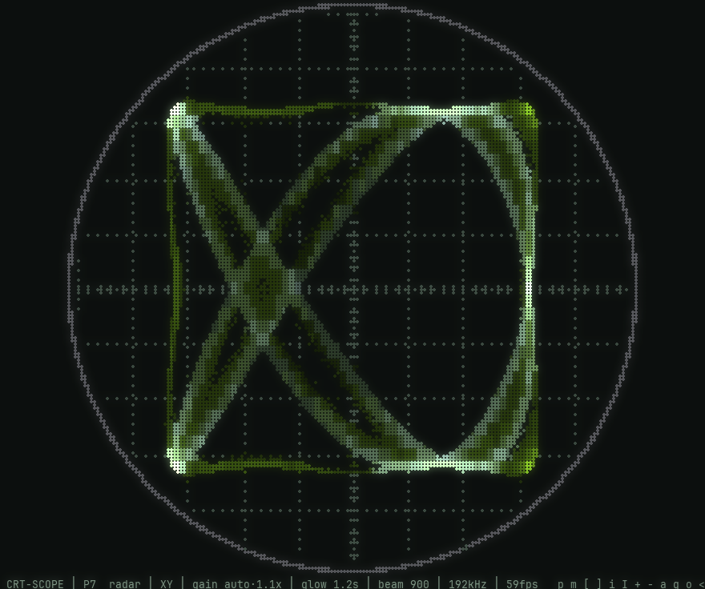
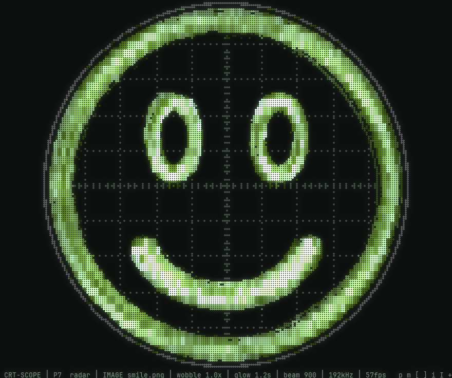
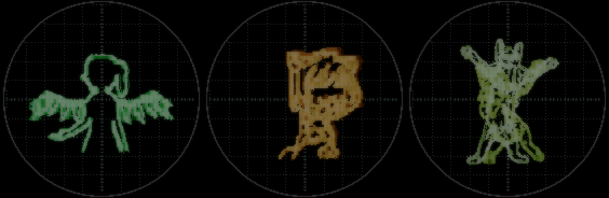
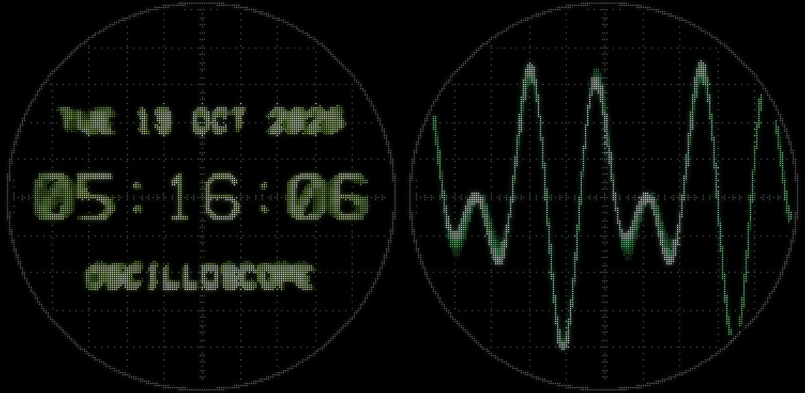
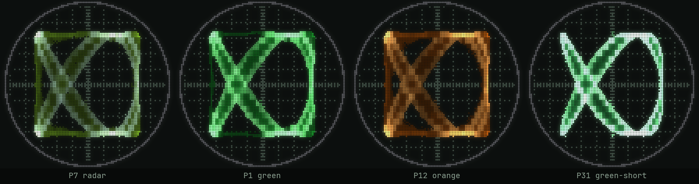
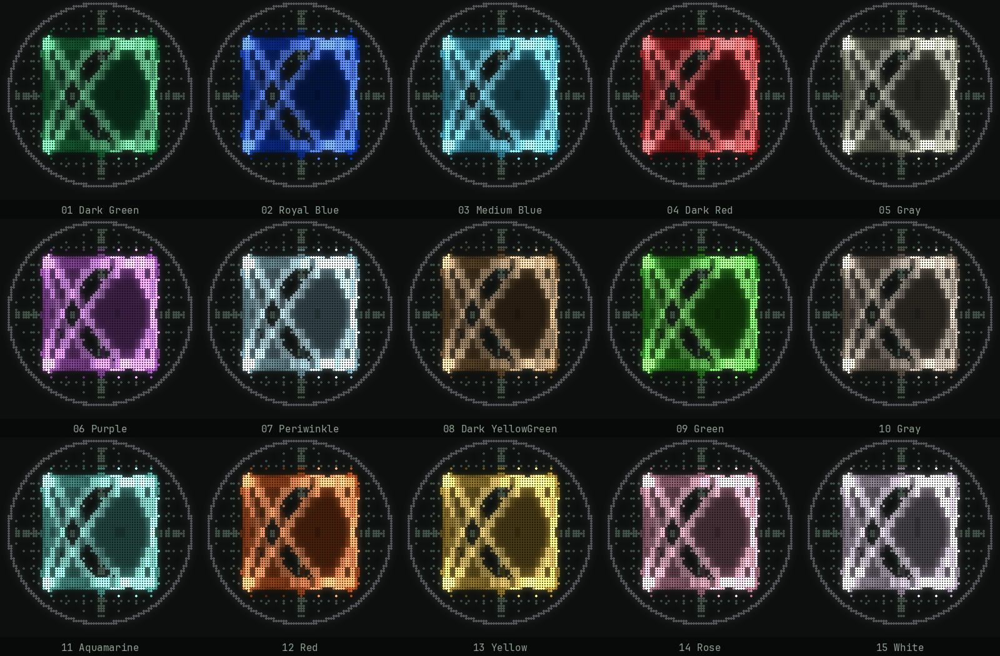

# crtscope

A 1960s military cathode ray tube in your terminal, driven by whatever your
speakers are playing.

The left channel moves the beam sideways and the right channel moves it up and
down, so stereo sound draws Lissajous figures. The beam leaves phosphor glow
behind that fades over time, and it burns brighter where it moves slowly, just
like a real tube. Round glass face, bezel, etched graticule, dimmer edges.

<p align="center">
  
  
</p>

## Trace an image

Give it a picture and the beam draws its outlines instead of the Lissajous
pattern, like oscilloscope music that draws pictures. The music is fed into the
same deflection as the picture, so the lines wobble and ripple with the sound,
bass hits make the picture pulse bigger, and loud parts make the beam burn
brighter. In quiet moments it settles back to a dim, steady picture.

```sh
python3 crtscope.py logo.png
```

Or skip the command line: press **Tab** while it's running to browse your
`~/Pictures` folder, then pick an image with the arrow keys and Enter. The menu
also has an entry to go back to the plain scope.

Logos, line art, icons and high-contrast pictures work best; busy photos turn
into a lot of little squiggles. Transparent PNGs use their shape's edge.
`+` / `-` set how strongly the music bends the lines.

## Bad Apple mode: play a GIF or video

Give it a GIF or a video and the beam traces every frame's outlines as it plays,
the way people play "Bad Apple!!" on real oscilloscopes. Black-and-white
silhouettes work best; busy cartoons turn into a tangle of lines.

<p align="center">
  
</p>

```sh
python3 crtscope.py bad-apple.gif
python3 crtscope.py music-video.mp4     # plays its soundtrack too; --mute to skip it
```

Or press **Tab** and pick one; videos are marked with ▶. Frames are traced on all
your CPU cores while it plays, so it starts within about a second. A video's own
soundtrack plays along, so its music bends its own picture. While a video plays
the afterglow is kept short, otherwise the frames would smear together.

Videos need `ffmpeg`; GIFs don't.

## Waveform and clock

<p align="center">
  
</p>

Press `m` to step through the modes: **XY** (Lissajous), **goniometer**,
**waveform** and **clock**.

- **Waveform** is a scope's classic view: the sound wave sweeping left to right.
  It's triggered like a real scope, so repeating sounds stand still instead of
  rolling. `t` / `T` speed up / slow down the sweep.
- **Clock** writes the time and date in a single-stroke vector font, like the
  old DIY oscilloscope clocks, plus the song that's playing in Spotify, your
  browser or any player that reports it to the desktop. Long titles show a page
  at a time.

## The tube

It powers on like an old tube (a dot opens into a line, then the picture) and
collapses to a line and a fading dot when you quit; press any key to skip that,
or start with `--no-power`. `f` cycles tube flaws: **subtle** (the default)
adds a faint 60Hz mains hum to the beam, slightly soft focus toward the rim
and a little flicker; **worn** makes them obvious; **off** is a perfect tube.

## Phosphors



| # | Phosphor | Look |
| --- | --- | --- |
| 1 | P7 radar (default) | blue-white flash, long yellow-green afterglow |
| 2 | P1 green | classic scope green, medium glow |
| 3 | P12 orange | orange radar glow |
| 4 | P31 green-short | crisp green, almost no trail |

### Apple II colours (5–19)

The Apple II's composite colours, sampled from a photo of a real monitor, as
extra beam colours: 01 Dark Green, 02 Royal Blue, 03 Medium Blue, 04 Dark Red,
05 Gray, 06 Purple, 07 Periwinkle, 08 Dark YellowGreen, 09 Green, 10 Gray,
11 Aquamarine, 12 Red, 13 Yellow, 14 Rose, 15 White. `--phosphor 5` is 01 Dark
Green, up to `--phosphor 19` for 15 White.



## Run it

Needs Python 3, numpy, and `parec` (PulseAudio or PipeWire) to hear what your
speakers are playing. Use a terminal with truecolor support.

```sh
python3 crtscope.py               # listen to system audio at 192kHz
python3 crtscope.py --demo        # 3:2 test tone, no audio needed
python3 crtscope.py cat.png       # trace an image instead
python3 crtscope.py --mic         # listen to the microphone instead
python3 crtscope.py --mode clock  # start as a clock (also: xy, gonio, wave)
python3 crtscope.py --flaws worn  # an old, tired tube (also: off, subtle)
python3 crtscope.py --phosphor 2 --square --fps 144
python3 crtscope.py --phosphor 10       # Apple II 06 Purple
```

### Windows

Install Python 3 from [python.org](https://www.python.org/downloads/), then in a
terminal:

```bat
pip install numpy pillow soundcard
python crtscope.py
```

It records what your speakers play through Windows' own loopback capture (no
extra setup), at whatever rate your sound device uses. Run it in **Windows
Terminal**; the old console window is much slower. To play videos (not GIFs)
install ffmpeg too, for example `winget install ffmpeg`. The song title in clock
mode is Linux-only for now.

Simple tones, synth pads and "oscilloscope music" look best. Busy mixes turn
into a glowing ball of noise, as they would on a real scope.

## Keys

| Key | Does |
| --- | --- |
| Tab | browse ~/Pictures and pick an image, GIF or video (↑↓ Enter, ← back, Tab/Esc close) |
| `p` / `P` | next / previous colour |
| `m` | mode: XY / goniometer (mono shows as a vertical line) / waveform / clock |
| `t` / `T` | waveform: faster / slower sweep |
| `f` | tube flaws: off / subtle / worn |
| `[` / `]` | shorter / longer afterglow |
| `i` / `I` | dimmer / brighter beam |
| `+` / `-` | gain (how much the music bends the lines, with an image) |
| `a` | auto gain on/off |
| `g` | graticule on/off |
| `o` | round tube / square screen |
| `<` / `>` | squash / stretch sideways (only needed if your terminal hides its cell size) |
| `h` | hide the info bar |
| `q` / Esc | switch off and quit (any key skips the power-off) |
